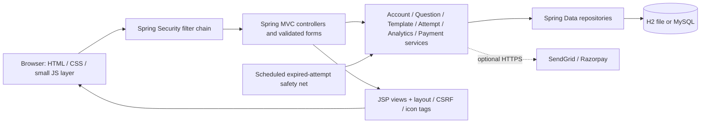
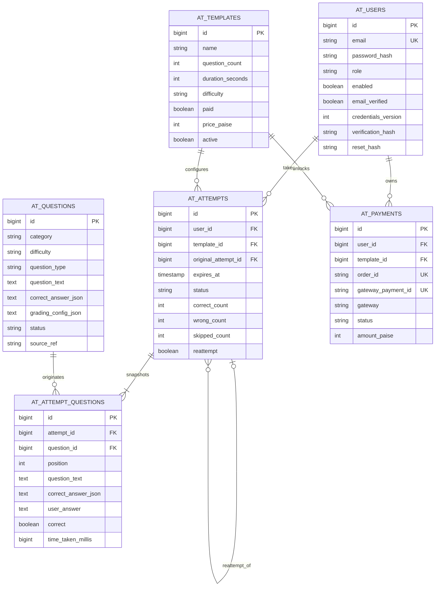
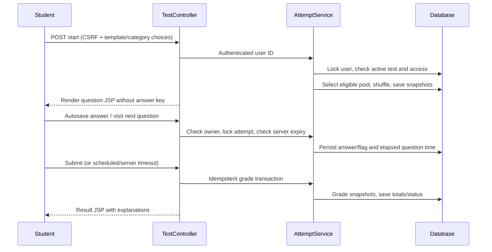
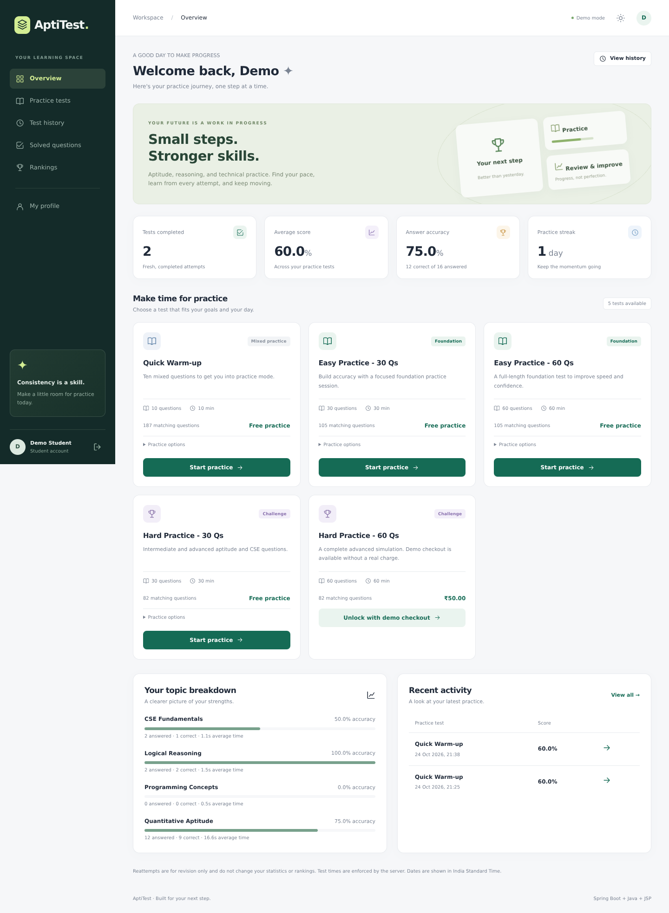
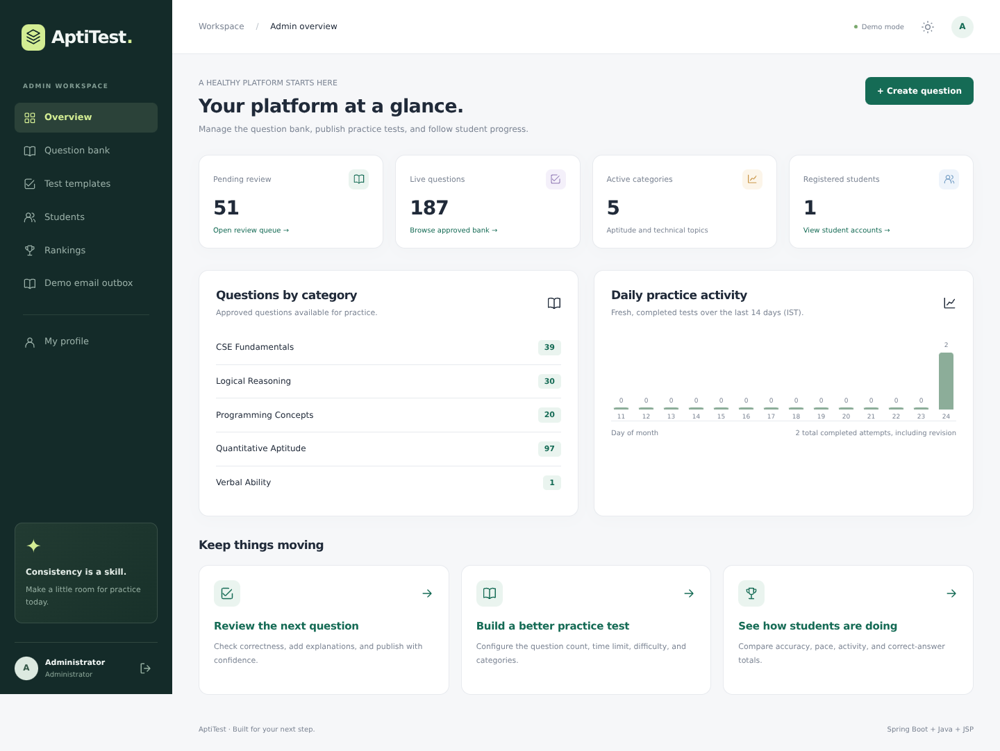

# AptiTest
## A Java Spring Boot and JSP practice-test platform for CSE / IT students

### Abstract

AptiTest supports structured aptitude and technical practice with immediate post-test feedback. Students take timed tests, resume saved work, review explanations, track topic performance, and compare progress. Administrators curate questions, publish configurable templates, inspect results, and manage student access. This version migrates the original JavaScript application to a layered Java MVC application packaged as an executable WAR.

The default deployment is self-contained: embedded Tomcat/Jasper serves JSP pages, H2 stores data on disk, and deterministic seed data makes the platform immediately demonstrable. Optional MySQL, SendGrid, and Razorpay settings allow further deployment work without making external accounts a prerequisite for evaluation.

## 1. Problem statement and objectives

Students preparing for placement and technical assessments need convenient topic-based practice and feedback that identifies weak areas. A practice platform also needs a controlled question bank, consistent grading, accurate timing, and access controls that cannot be bypassed in the browser.

Objectives:

1. Replace the React/Bun runtime with Java, Spring Boot, and JSP.
2. Preserve the main admin/student workflows and reusable repository question data.
3. Make setup reproducible without a separately provisioned database or secret API keys.
4. Separate web handling, business rules, persistence, and presentation.
5. Validate grading, authorization, timing, and real JSP rendering automatically.
6. Provide clean source and executable artifacts suitable for submission.

## 2. Technology stack

| Layer | Implementation |
|---|---|
| Language/runtime | Java 17 target; compatible Java 17/21 deployment |
| Application framework | Spring Boot 3.5.16, Spring MVC |
| Presentation | JSP, Jakarta JSTL, reusable JSP tag files |
| Browser enhancements | Local CSS and vanilla JavaScript; no frontend build |
| Security | Spring Security, BCrypt, CSRF, server-side sessions |
| Persistence | Spring Data JPA / Hibernate; H2 default, MySQL optional |
| Container | Embedded Tomcat 10.1 + Jasper; executable WAR |
| Email/payment | Demo adapters; optional SendGrid REST and Razorpay |
| Build/test | Maven Wrapper, JUnit 5, Spring Boot Test, MockMvc, black-box HTTP smoke suite |

## 3. Architecture

Controllers handle request binding, authorization context, redirects, and presentation models. Services own validation and transactional business rules. Repositories provide persistence and row locking. JSPs render escaped data and forms; they contain no SQL or Java scriptlets. JavaScript enhances autosave, timers, theme, and navigation but never decides scores or permissions.

## 4. Actors and modules

### Student

- Verified registration, sign in/out, profile and password management.
- Free/paid template selection and optional category/repeat filters.
- Timed tests with random, non-duplicate question selection; unseen-question filtering.
- Saved answers, resume, review flags, navigation, and automatic submission.
- Result and explanation review, printable output, solved bank, history, and revision reattempts.
- Topic analytics and accuracy/score/activity/pace rankings.

### Administrator

- Dashboard with question/student counts, category distribution, and a 14-day activity trend.
- Question search/filter, create/edit, review approval/rejection, deactivate, and atomic JSON import.
- Template question-count/time/difficulty/category/type/subcategory settings; free/paid configuration; archive.
- Student search, detailed performance/history/results, and enable/disable with session revocation.
- Private in-memory email outbox during a demonstration.

## 5. Data model

Foreign keys preserve referenced accounts, templates, and questions. The question-position pair is unique within each attempt. Services use scalar IDs for straightforward authorization, while read-only JPA associations generate database relationships. There are no cascading destructive admin operations. Question details/answers/configurations are copied into attempt rows, so editing the bank cannot retrospectively alter a test.

## 6. Test lifecycle

An existing active session is resumed rather than duplicated. The user row serializes start requests; attempt row locks serialize save/submit/timeout operations. Question time accumulates while a question is active, including the interval until a server action or deadline. The scheduled job is a safety net; every answer/view operation also checks expiry, so a slow scheduler does not permit late answers.

Each correct answer awards one mark. There is no negative marking. All skipped questions remain part of the score denominator. Boolean false and numeric zero are valid answers. Fractions compare equivalent values, ratios support multiple terms, numerical tolerance and units are configurable, and multi-select requires an exact set match.

## 7. Metrics

- **Score:** correct answers / total questions × 100.
- **Accuracy:** correct answers / answered questions × 100.
- **Average score:** mean completed fresh-attempt percentage.
- **Topic performance:** answered/correct totals and average viewed-question time.
- **Streak:** consecutive practice days through today, or yesterday if today has no completed fresh test (IST).
- **Rankings:** accuracy, total correct, fresh completed test count, or elapsed seconds per answered question. Students need at least one answered question in a completed fresh test to rank.
- **Revision:** reattempts are stored and reviewable but excluded from cumulative statistics/rankings.

## 8. Question data and migration

The seed bank contains 238 questions: 49 approved original report items, 51 flagged items kept pending, and 138 supplemental demo items. Provenance is retained. Five templates include the original 30/60-question easy/hard configurations and a quick warm-up. Both 60-question pools have enough active questions.

The old hosted database was not available as an export in the repository, so no real users, payments, or history migration is claimed. [MIGRATION.md](MIGRATION.md) describes safe import and remaining work.

## 9. Implementation highlights

- Spring Security protects server routes, not just menu links.
- Password/token data are never stored in browser localStorage; only theme preference is.
- BCrypt input limits account for UTF-8 bytes.
- Bans/password resets revoke previously issued sessions.
- Escaped plain-text question rendering prevents imported HTML from becoming executable content.
- Atomic imports roll back on any invalid row.
- Source references make seed initialization repeatable without overwriting edits.
- Template archiving and immutable question snapshots preserve history.
- Default demo email/checkout remove external account prerequisites without pretending to deliver/charge.
- WAR packaging deliberately accommodates JSP, with both executable and servlet-initializer entry points.

## 10. Verification and screenshots

See [TEST_REPORT.md](TEST_REPORT.md) for executed tests, environment details, and explicitly untested integrations.

Additional screenshots: [sign in](screenshots/01-login.png), [test](screenshots/03-practice-test.png), [result](screenshots/04-result.png), [mobile dashboard](screenshots/06-mobile-dashboard.png). These show the actual application, not design mockups. The displayed demo result comes from an exercised ten-question browser flow.

## 11. Limitations and future work

The application is an educational practice platform, not a proctored exam system. Production work includes controlled schema/data migrations, rate limiting, audit logging, observability, shared session storage if scaled, large-dataset analytics optimization, and provider webhooks/refunds/reconciliation. Real MySQL and provider connections must be tested with private deployment credentials. The full scope and security boundaries are documented in [SECURITY.md](SECURITY.md).

## 12. Conclusion

The migration provides a working Java/Spring/JSP application with a reproducible build, persistent local data, complete core user flows, deterministic grading, server-side controls, automated verification, and clean submission artifacts. It preserves the original source for reference while making the runnable hand-in independent of the old JavaScript runtime.
